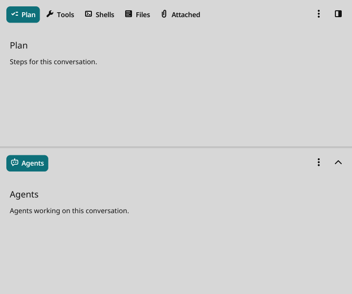
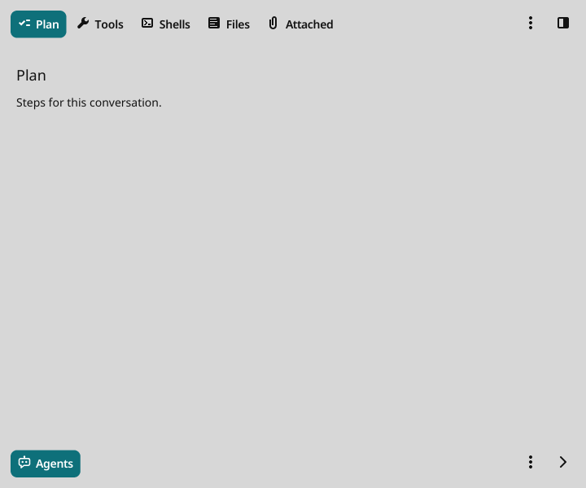
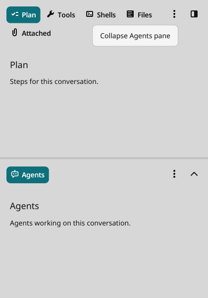

# Native panel example

Native tiny-skia captures of the shared two-pane fixture, not the Terminal UI.
The example exercises a wrapped navigation header, trailing controls, a draggable
double-line divider and pane collapse/expand. Content is illustrative.

Expanded:

After activating the lower pane's collapse control:

At a narrower width, navigation wraps while the controls remain at the top right:

The event tests exercise resistant dragging across native rebuilds, restoration
of saved sizes, whole-panel hide/reopen and popup-menu collapse. These still
images do not establish animation quality or cross-window resource retention.
See [capture and validation provenance](provenance.txt) for source hashes and
checks; the recorded source hashes were verified again before packaging.
